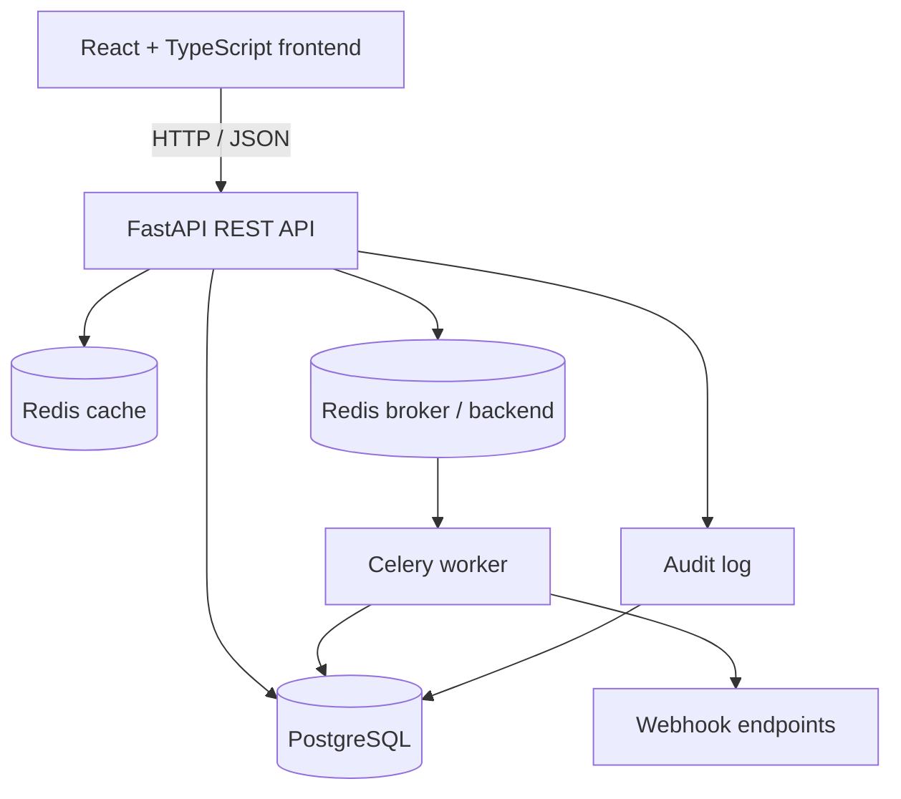

# TaskFlow — Workflow & Task Management Platform

A full-stack workflow and task management application built around a multi-tenant REST API. TaskFlow lets users organise work into workspaces, manage projects and tasks, control access by role, and automate actions when tasks are completed.

> **Status:** Local development build. The TaskFlow frontend and API are available locally; a public TaskFlow demo URL will be added after deployment.

## Overview

TaskFlow is designed as a production-style backend project with a React frontend. It combines REST API development, relational data modelling, authentication and authorization, automated testing, background jobs, caching, and Docker-based local infrastructure.

## Features

- **Authentication:** user registration, password hashing, login, and JWT bearer authentication.
- **Workspaces:** create and list workspaces, with membership-based access.
- **Role-based access control:** `owner`, `admin`, `member`, and `viewer` roles with different permissions.
- **Projects:** create, list, view, update, and delete projects within a workspace.
- **Tasks:** create, list, view, update, complete, assign, and delete tasks.
- **Task filtering:** filter by status, priority, assignee, and text search.
- **Idempotent writes:** use `Idempotency-Key` on supported create operations to prevent duplicate effects on retries.
- **Audit log:** record and read workspace activity, including project changes.
- **Automation rules:** react to the `task.completed` event, optionally match task priority, and trigger notifications.
- **Notifications:** retrieve notifications for the current user in a workspace.
- **Webhooks:** configure endpoints and subscribe to supported project/task events; delivery runs asynchronously with retry handling.
- **Redis caching:** cache project and task lists where Redis cache configuration is available.
- **Background processing:** Celery workers handle asynchronous notifications and webhook delivery.
- **Automated tests and CI:** pytest suite, coverage reporting, and a GitHub Actions workflow.
- **Web interface:** React + TypeScript frontend for working with the API without using Swagger for everyday tasks.

## Tech Stack

| Area | Technologies |
|---|---|
| Backend | Python 3.12, FastAPI, Pydantic v2 |
| Database | PostgreSQL, SQLAlchemy, Alembic |
| Authentication | JWT bearer tokens, password hashing with Argon2 |
| Caching and task broker | Redis |
| Background jobs | Celery |
| Frontend | React, TypeScript, Vite |
| Testing | pytest, pytest-cov, FastAPI TestClient |
| Infrastructure | Docker, Docker Compose |
| CI | GitHub Actions |

## Architecture



The API authenticates requests with JWTs. Workspace membership determines whether a user can access a workspace and which actions their role permits. PostgreSQL stores application data; Redis supports caching and Celery messaging; the worker processes notifications and webhook deliveries in the background.

## Project Structure

```text
TaskFlow/
├── app/
│   ├── routers/             # FastAPI endpoint groups
│   ├── auth.py              # Password hashing and JWT validation
│   ├── automation_engine.py # Event/condition/action dispatch
│   ├── celery_app.py        # Celery configuration
│   ├── celery_tasks.py      # Background notifications and webhooks
│   ├── crud.py              # Business/database operations
│   ├── database.py          # SQLAlchemy engine and sessions
│   ├── idempotency.py       # Idempotent request handling
│   ├── models.py            # SQLAlchemy models
│   ├── permissions.py       # Workspace membership and role checks
│   ├── redis_cache.py       # Redis cache helpers
│   ├── schemas.py           # Pydantic request/response schemas
│   └── webhook_service.py   # Webhook validation and dispatch
├── alembic/                 # Database migrations
├── frontend/                # React + TypeScript + Vite UI
├── tests/                   # Automated tests
├── .github/workflows/       # CI workflow configuration
├── Dockerfile
├── docker-compose.yml
├── alembic.ini
└── requirements.txt
```

## Getting Started

### Prerequisites

- Python 3.12
- Node.js and npm
- Docker Desktop with Docker Compose
- Git

### Option 1: Run the backend and infrastructure with Docker Compose

1. Clone the repository and open its root directory:

   ```bash
   git clone https://github.com/ArtKing366/TaskFlow.git
   cd TaskFlow
   ```

2. Create a `.env` file in the repository root. Do not commit it. At minimum, configure the secret used for signing JWTs:

   ```dotenv
   SECRET_KEY=replace-with-a-random-secret-of-at-least-32-bytes
   ```

   The Compose configuration provides the database and Redis connection values to its containers. If your local configuration requires additional environment variables, set them in `.env` or in `docker-compose.yml` as appropriate.

3. Build and start PostgreSQL, Redis, the API, and the Celery worker:

   ```bash
   docker compose up --build
   ```

4. Open the API documentation:

   - Swagger UI: <http://127.0.0.1:8000/docs>
   - OpenAPI schema: <http://127.0.0.1:8000/openapi.json>

Stop the services with `Ctrl+C`. To stop and remove the containers while preserving database data, run `docker compose down`. **Do not use `docker compose down -v` unless you intend to delete the database volume.**

### Option 2: Run the frontend locally

Keep the backend running on `http://127.0.0.1:8000`, then open a second terminal:

```bash
cd frontend
npm install
npm run dev
```

Open the local URL printed by Vite (normally <http://localhost:5173>). The Vite development proxy forwards frontend API requests to the local FastAPI server.

### Run the backend directly (without the API container)

If you prefer to run FastAPI outside Docker, ensure PostgreSQL and Redis are running and that the root `.env` file contains connection settings for services reachable from the host. Then run:

```bat
py -m venv .venv
.venv\Scripts\activate.bat
py -m pip install -r requirements.txt
py -m alembic upgrade head
py -m uvicorn app.main:app --reload
```

On macOS/Linux, activate the virtual environment with `source .venv/bin/activate` and use `python -m ...` instead of `py -m ...`.

## Testing and Coverage

Create/activate the virtual environment, install dependencies, ensure a dedicated test database is configured, and run:

```bash
py -m pytest tests -v --cov=app --cov-report=term-missing --cov-fail-under=75
```

The current recorded result is **45 passing tests** and **75.64% total coverage**. Results may change as code or tests are modified. The test database should be separate from development/production data.

## API Overview

All protected endpoints require an `Authorization: Bearer <access_token>` header. Obtain a token through `POST /auth/login`.

| Area | Endpoints |
|---|---|
| Authentication | `POST /auth/register`, `POST /auth/login`, `GET /auth/me` |
| Workspaces | `POST /workspaces`, `GET /workspaces`, `GET /workspaces/{workspace_id}` |
| Workspace members | `POST /workspaces/{workspace_id}/members`, `PATCH /workspaces/{workspace_id}/members/{user_id}/role`, `DELETE /workspaces/{workspace_id}/members/{user_id}` |
| Projects | `GET/POST /workspaces/{workspace_id}/projects/`, `GET/PATCH/DELETE /workspaces/{workspace_id}/projects/{project_id}` |
| Tasks | `GET/POST /workspaces/{workspace_id}/projects/{project_id}/tasks`, `GET/PATCH/DELETE /workspaces/{workspace_id}/tasks/{task_id}`, plus complete and assign actions |
| Audit logs | `GET /workspaces/{workspace_id}/audit-logs/` |
| Automations | `GET/POST /workspaces/{workspace_id}/automations/`, `GET/PATCH/DELETE /workspaces/{workspace_id}/automations/{automation_id}` |
| Notifications | `GET /workspaces/{workspace_id}/notifications/` |
| Webhooks | `GET/POST /workspaces/{workspace_id}/webhooks/`, `GET/PATCH/DELETE /workspaces/{workspace_id}/webhooks/{webhook_id}` |

Project, task, and automation creation require an `Idempotency-Key` header. Check `/docs` for the exact request schemas, query filters, and response models.

## Configuration Notes

- Keep `.env`, API keys, database passwords, and production secrets out of Git.
- Use a long random `SECRET_KEY`; do not use a placeholder in any public deployment.
- Keep PostgreSQL and Redis ports private on production infrastructure.
- The cache helper reads `REDIS_CACHE_URL` (separate from the Celery `REDIS_URL`). In the Compose `app` service, set `REDIS_CACHE_URL: redis://redis:6379/1` so the API container reaches the Redis service by its Compose hostname.
- Webhook endpoints must use HTTPS and resolve to public IP addresses; local/private addresses are rejected by the application.
- The public TaskFlow demo is not deployed yet. Add its URL here after the deployment has been completed and verified.

## License

No license has been specified for this repository yet.
